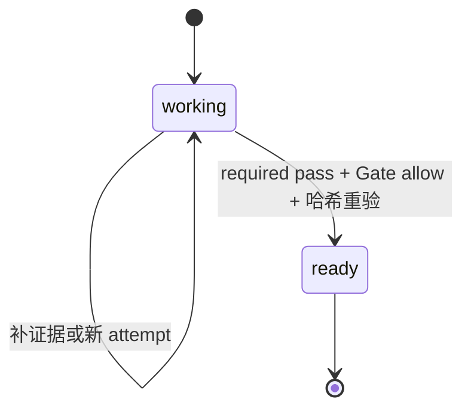

# humanization Verifier / State 设计与实施计划

## 结论摘要

按用户授权，将 humanization 的版本更新为 2.0.0，采用 `working → ready` 两个领域 State、一个 required 混合 Verifier 和一个 Skill 自有编排入口。保留现有润色规范与输出模式，不修改 Kernel。计划先落盘，主 Agent 连续实施，无额外审批。

依据：目标现有 SKILL/config/检查器与三份写作参考；`verifier-state-architect` 的托管、生产运行时和编排规范；本轮两个独立评估及一个总结。协作材料在任务目录 `parallel-vibe/2026-11-08-14-07/`。当前托管 BSK 经安装器强制检查为 2.1.6，Python 3.12.14；目标只声明包名，不固定 Kernel 版本。

## 业务流程与风险地图

现有流程为理解、保护、诊断、优化、限定审查、语义核对与原稿比较。主要风险是跳过内部要求、把词法 pass 当作语义安全、普通英文被误冻、审查后改稿复用旧批准，以及诊断/摘要/风格卡未经审查。BSK 管执行证据和阶段身份；真实语义及阅读收益仍由宿主审查。

## 删除影响测试（含“不接入”结论）

| 对象 | 删除后的可观察损失 | 决定 |
| --- | --- | --- |
| required 语义审查 | 分母、阈值、数字归属、独立限定变化仍可词法通过 | 保留 |
| 文件/参数哈希及交付前重验 | 可对已批准稿件换字后沿用批准 | 保留 |
| 唯一编排入口 | 必需检查、身份和 Gate 可被漏用或误接 | 保留 |
| working / ready | 待审查、获准交付与恢复窗口不可机器区分 | 用户明确要求 State，保留 |
| 每个动作一个 State、八维独立 Verifier | 无独立新增边界 | 不接入 |
| 新通用 Pack / Kernel 领域规则 | 无两个不相邻领域复用证据 | 不提炼 |

## Verifier 设计矩阵

| 候选 | 命题与分工 | 证据与 Gate | 失败与人工复核 |
| --- | --- | --- | --- |
| `bensz.prose.revision-readiness` | 一个 Pack：script 检查绑定、参数、结构并收集字面 facts；required agent 审查保全、差异和净改善 | 当前原文、交付物、附件、参数的冻结索引；全部组件 pass 才放行 | 缺失、fail、uncertain、unchecked、error、timeout 均不放行；不确定改写回退原文后重审 |

固定 VERIFIER 五段正文；身份/版本/组件只在集合 index 定义。脚本不编码阈值、分母或自然度结论。普通英文词法 fail 作为需解释事实，不自动否定合法润色。

## State 设计矩阵与最小状态图

| State | 真实含义 | 条件 |
| --- | --- | --- |
| `bensz.revision.working` | 正在准备或审查，尚不可交付；pending 留在本态 | 离开需要当前 run/visit/attempt 的 required 结果和绑定 Gate |
| `bensz.revision.ready` | 冻结产物已获准交付，未声称已经发送 | 终态；只可取回同一冻结产物，不再改写 |

只声明 Kernel 已实现的 invariant：`verifier-result-recorded`、`required-verifiers-pass`、`verifier-gate-allow`。领域约束由 Pack/入口执行，不能把自然语言 invariant 当作引擎检查。

## AI/确定性分工与 Evidence Contract

确定性部分验证请求/枚举、路径、普通文件、体积、原文和交付对象字节、有效参数、requested/effective structure mode、审查记录非空及来源锚点、运行和组件绑定。字面扫描保留原始结果，复杂 TeX/英文走明确语义核对。

语义审查双向追溯：原文事实/意图/限定 → 改稿；改稿新增主张 → 原文。按配置的 `require_*` 检查记录术语、不变量、保护差异、边界处置和原文比较，允许有理由的不适用；不能只提交布尔值。审查结果包含 summary、confidence、uncertainties、来源/候选锚点、复核轮次和 revise/keep_original/diagnosis 决定。诊断不是伪候选，零 diff 是合法成功。摘要、风格卡一并纳入哈希和审查。

BSK 事件仅保存哈希、相对引用与最小结果；正文只保留于用户授权的本地 input/output。审查记录使用字符区间锚点，避免把原文重复写进账本。

## Kernel 对接、Gate、重放与资源边界

采用 `state-identity-v2`。required 清单由 `SkillVerifierDeclaration.verifier_requirements()` 解析；`run_contract()` 执行并生成 Agent handoff；真实宿主结果绑定返回。完整 `to_event_payload()` 交给 `EventLog.record_verification_batch(..., gate={}, requirements=...)`，Kernel 重新计算 Gate。transition 固定使用托管 CLI，绑定 Gate event、evidence hash/ref 与 source identity；核对新快照、版本及事件。

受限路径均在任务根内，拒绝绝对路径、`..`、symlink、非普通文件、未知参数和超量输入。子进程参数数组、超时、无 shell。运行时通过安装器强制更新、固定托管 Python/CLI；不能以裸 PATH 或仓库源码包冒充生产。

pending 可恢复；改原文、参数或候选需要新 attempt，旧 handoff/Gate 不复用。契约漂移拒绝继续，保留证据，不能擅自换任务根。重放仅投影事件，不调用模型。

## BSK 单一编排入口

`scripts/control.py` 是受控交付正常唯一入口；`init` 绑定原文和参数，`release` 首次冻结交付物并生成 handoff、收到真实结果后统一执行 required/Gate/transition，`retry` 建立新 attempt，`status` 读取当前状态。action 映射写 `runtime.orchestration`。底层命令仅供入口、诊断或恢复。

回执含稳定 protocol/action/run/attempt/previous/target/current State、required_results、gate、transition、status；失败含 reason_code/recovery。退出 0、文件存在或自报 pass 都不构成放行。每次 release 重验文件；ready 状态取回也只接受同一冻结字节。

## Kernel 复用与元 Verifier/State 提炼决策

| 能力 | 现有 Pack / 底层 | 复用与差异 | 提炼结论与验证 |
| --- | --- | --- | --- |
| 身份、handoff、Gate、事件、证据绑定 | BSK 2.1.6 公开 API/CLI | 直接复用；已有错绑拒绝与重放，领域无须重建底座 | 不改 Kernel；真实闭环和负例验证 |
| 路径 | `bensz.artifact.path-scope@1.0.0` | 不增加 required；空 targets 可通过，不能替代入口非空/存在/普通文件检查 | 已有通用能力，不新增顶层 Pack |
| 来源 | `bensz.evidence.provenance@1.0.0` | 不增加 required；只查字段不重算字节，无法证明当前稿件 | Skill 适配器重算，避免无收益组件 |
| schema / 合同 | `bensz.artifact.schema-conformance@1.0.0` / `bensz.contract.conformance@1.0.0` | 顶层存在性不能覆盖嵌套审查与参数语义；留在 Skill 适配器 | 不提炼；无跨领域稳定新契约 |
| 语义及阅读改善 | 专用 revision-readiness | 不适用内置判断；限定、语气、英文差异属于润色领域 | 一个专用混合 Pack；真实宿主执行 |

复用结论：共享身份/执行/审计直接复用，领域收集和判断留在 Skill；这样不复制底座，也不扩展中央 dispatcher。元组件结论：不提炼新 Pack；新增规则删除 humanization 后失去主要意义，且无两个不相邻领域的真实复用证据，独立版本化只增加耦合。

## 实施顺序（P0/P1/P2）

1. P0：Pack/index/config 与唯一控制入口；完整身份、动态 required、字节绑定和 fail-closed。回退为恢复本轮基线，不移除用户改动。
2. P0：真实审查 schema 与 handoff，保留英文/诊断/免改；修复已复现的 math-only reflow 漏检。
3. P1：状态/事件重放、恢复、异常回执和复制发现验证；同步双语指南、CHANGELOG 与 BAC。
4. P2：不扩展润色风格、领域模板或 Kernel；不修改既有社区调查计划。

## 验收与回归测试

托管结构检查、Skill strict 结构和 README 对齐；现有保护器回归；真实完整 init → handoff → 宿主审查 → Gate → ready → 重放；正常英文、诊断、原文免改。负例覆盖未知 action、状态错配、required 缺失/失败/不确定、旧 attempt/handoff、稿件/参数篡改、缺审查条目、Gate 错绑/非放行、transition 错目标/版本/快照、路径/symlink/体积以及超时。协议故障用合成探针，语义成功必须真实执行并如实标注同模型局限。

多轮最多三轮，每批两个独立评估→一个总结→主 Agent 单点执行。第一轮建立接入，第二轮从独立反例及保留案例审查；可信改进才晋升最佳，连续两轮无改进或目标满足停止。保存基线和各轮差异，可恢复但不做破坏性 Git reset。

## 已知不确定性、回退方案和不在范围内的事项

BSK 只能控制经过入口的行为，不能强制拦截宿主直接聊天/写文件。Agent 身份与结果绑定不等于语义真值或独立盲评；本次不宣称自然度整体提升。缺托管运行时或真实审查时拒绝“受控已通过”，保留草案。安装验证只用临时副本，不覆盖系统 Skill，不发布或远程写入，不修改 Kernel。

## 实施对账与最终验证

实际交付与上述最小设计一致。`runtime.states` 另列内置 workspace.ready 以支持严格初始化；领域 State 仍只有 working/ready。未新增 Kernel 代码、顶层 Pack 或额外编排框架。

三轮均采用智能模式，每轮两个上下文独立的只读评估 → 一个只读总结 → 主 Agent 唯一实施。评估来自同一宿主能力，证据域不同，不代表模型偏差完全独立。各批次结果与日志位于唯一任务工作区的 `parallel-vibe/`，基线和每轮最佳可恢复。

| 轮次 | 评估域与接受理由 | 验证 |
| --- | --- | --- |
| 1 | 契约与生产运行时；落实两态/单 Verifier/单入口，首次形成合格接入 | 74 项回归及四类真实主宿主审查；只作为第一轮证据 |
| 2 | 完整性与格式/参数反例；修复可变回执信任、ready 后缺回执卡死、Setext/缩进/TeX 漏判与默认轮数冲突 | 94 项受影响回归通过，反例转绿；接受为新最佳 |
| 3 | init/retry 中断与附件保留案例；修复提交先于会话导致的恢复窗口、无效 retry 的身份副作用及文件别名去重 | 120 项回归通过，包括实际退出码 73 的进程中断、原子替换故障和同身份恢复；接受为最终最佳 |

第三轮恢复意图仅用于两个入口操作的本地提交协调，不增加领域 State。输入先校验，再保存绑定意图并调用幂等 BSK；release 在意图未完成时拒绝，恢复不能接管不匹配身份。ready 回读从 transition、Gate、当前 required 结果与冻结字节重建，不信任 release.json。该恢复范围不包括底层事件存储损坏。

最终采用固定托管 Python 3.12.14 / BSK 2.1.6；pytest 显式清空仓库 pythonpath，防止源码 Kernel 混入。121 项最终运行/保护测试中的语义 submission 是明确标注的合成协议样例，仅证明机械门禁。另有 2 项正式名/旧名隔离安装回归，并从无关目录用生产 CLI/API 发现安装后的 State/Verifier。Pack 集成检查只证明 hosting/loader/声明，真实执行另行验证。安装器有一条既有 locale 弃用警告。

最终版真实主宿主链使用临时复制 Skill，实际执行入口中的生产运行时确认、init、handoff、阅读原文/全部附件、绑定回传、Gate、transition、事件重放与 ready 回读：

| 案例 | 字面事实与真实判断 | 结果 |
| --- | --- | --- |
| 普通英文 | 字面 fail 来自普通词编辑，Export、CSV only 与导出前时序保持 | allow / ready / bound |
| 科学边界负例 | 字面 pass，但严格超过改成达到、全纳入分母改为可评分，丢失患者获益边界；摘要声称保留也不成立 | reject / working |
| 科学边界恢复 | 新 attempt 撤回错误稿，原文逐字节恢复，摘要与风格卡一起重新审查 | allow / ready / bound |
| 原文免改 | 无可确认的阅读收益，保留请求力度、周五前时限和目的 | allow / ready / bound |
| 只做诊断 | 无伪候选；建议精简铺垫，保留时间与计划性质 | allow / ready / bound |

这些是主宿主真实审查的五次绑定结果，不是独立盲评；模型具体型号未由宿主披露。测试文本为合成短文，未覆盖长文、跨模型泛化或人类认可。第三轮的路径保留案例未指导前两轮修改；最终回归继续保留英文、诊断、免改和格式反例。

最终关键证据（均相对唯一任务工作区）：`skill-creator/log/final-regression.log`、`skill-creator/output/verified-live-review.json`、`skill-creator/log/verified-runtime-discovery.log`、`verifier-state-architect/log/verified-integration.log`、`write-readme/log/verified-readme.log`。完整 fixture 与 BSK 事件位于根级 `tmp/humanization-bsk-live-verified/`。测试运行脚本曾出现回执汇总对 null transition 的处理错误，修正临时汇总后继续；未改变业务放行结果。初次回归另有事件名拼写错误，修正测试后 120 项全部通过；最终对账补齐 Pack 执行脚本本身的资产哈希，增加漂移拒绝反例，最终 121 项通过，失败日志保留。

停止理由：三轮预算已执行，已复现的缺陷全部修复且必需门禁通过，目标满足；不继续增加可选优化。最终源码版本为 config 声明的 2.0.0，未提交、发布或更新系统 Skill。
