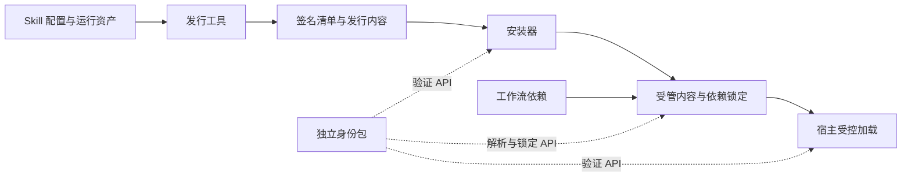

# Skill ID 系统优化与实施计划

本计划承接[身份基础设施设计讨论](../development-of-skill-identity.md)，将本轮已讨论认可的方向收敛为可分阶段实施的新特性：在 `packages/` 新建独立身份包，以现有 `config.yaml` 承载身份声明，通过自动生成的签名发行清单验证来源和内容，再逐步接入安装器与 Agent 宿主。

当前交付状态：**计划已编写，软件功能尚未实施**。文中的字段、结果类型和接口属于拟议契约；正式协议在首阶段冻结。本轮授权范围为编写计划，实际开发、生产密钥配置、系统安装和跨仓库接入按后续任务范围执行。

## 通俗解释：究竟要改善什么

目前，一个工作流要求使用某个 Skill，通常靠名称找到本地目录。同名目录可能来自另一位作者，里面的文件也可能与最初安装时不同。名称能帮助寻找，却不足以确认来源和实际内容。

这类似收货：`config.yaml` 中的身份是包裹上的商品标识，作者的签名是可核验的出厂证明，文件清单是装箱单，运行锁定记录则说明本次实际使用了哪一批货。作者负责发行，安装器负责验收，宿主负责使用验收过的那份内容。

例如，工作流要求使用 `research-literature-search`。改进后，即使项目里出现另一个同名 Skill，系统也能按发布者和稳定身份区分；若正版中的脚本被替换，则报告内容不一致。一次任务开始后，正常更新不会悄悄替换本次已锁定的依赖。

作者因此可以保持身份稳定，使用者可以核实发行来源，工作流维护者可以精确声明依赖，排查人员可以比较双方使用的具体内容。宿主接入完成后，验证证据还能对应到实际加载行为。

## 专业判断：现有基础与关键缺口

本轮核对了当前安装器、bootstrap、配置及既有包布局；router 与真实宿主能力沿用原讨论中的待验证假设，本轮未开展跨仓库或真实宿主验证。

| 已有基础 | 本轮核对结果 | 对新特性的影响 |
|---|---|---|
| Skill 配置 | `skill_info` 已承载名称、版本等信息 | 直接增加可选身份字段，无需新增人工维护的身份文件 |
| 安装更新判断 | 完整安装器和 bootstrap 都可能读取保存的 MD5 | MD5 继续服务兼容更新判断，不能代替实际文件与发布关系验证 |
| 安装过滤 | 当前会排除隐藏文件、部分文档和目录 | 签名发行不能套用这些过滤规则后仍声称文件集合完整 |
| 安装记录 | `.skill-manifest.<platform>.json` 写入 Skill 目录 | 受管发行须把可变记录放到内容目录外，避免额外文件与摘要冲突 |
| 安装替换 | 完整安装器远程路径已有 staging／备份；bootstrap 仍先移除目标再复制 | 验证须先于替换和关联清理，不能假定所有入口已具备一致恢复能力 |
| Python 边界 | 完整安装器与 BSK 要求 3.11+，bootstrap 支持 3.8 且仅用标准库 | 新包采用 3.11+；bootstrap 需要明确的委派与兼容路径 |
| BSK 身份模块 | 现有模块面向 State／Verifier 等对象 | Skill 发行身份另建独立协议，避免混用对象和信任语义 |

最重要的未知项是宿主能否在 Skill 描述和正文进入模型上下文前实施验证，并在使用时保持内容绑定。独立包可以完成身份和文件验证；发现、加载与工具执行的保证范围需要真实宿主证据。

## 要达到什么目标

将交付划分为两级，避免把可用的基础库与完整宿主防护混为一谈。

**基础版目标**：第三方程序无需安装 router 或 BSK，即可生成并验证 Skill 发行，区分同名身份，识别内容修改，得到结构化结果和固定依赖记录。交付同时包含一个候选宿主的能力报告，但不以完整 router 集成作为基础包完成条件。

**接入版目标**：安装器能够安全处理已签名发行；一个真实宿主能够在已验收的受控路径中加载固定内容；router 的结构化依赖在另行接入后可以追踪到该内容。各组件按各自完成状态报告能力。

首轮不建设公共市场、全球名称注册中心或复杂插件框架，不自动迁移所有 Skill，不接入 State／Verifier，不扩张 BSK 的认证职责。签名证明发布关系与内容完整性，不提供代码安全结论或文件、网络、进程权限。

## 改进方向

### 复用 config.yaml，建立唯一的身份声明来源

在已有 `skill_info` 下新增 `identity`，只维护发布者身份和稳定技能键。下面示例用于说明字段位置，发布者占位符不能作为真实 ID：

```yaml
skill_info:
  name: research-literature-search
  version: "1.2.0"
  identity:
    publisher_id: "<由发布者根公钥派生的身份>"
    skill_key: "research-literature-search"
```

`skill_id` 由这两个字段按确定格式组合，源码中不再冗余维护完整 ID。`name` 和目录名继续承担显示与发现作用；身份建立后，改名或迁仓库不改变 `skill_key`。Fork 使用新身份，作者显示名不能代替发布者身份。

读取配置只得到身份声明。验证器必须核对声明、发行清单和获授权签名的一致性；即使复制正版配置，也不能据此获得可信状态。`config.yaml` 的原始字节纳入发行摘要。

旧配置缺少身份字段时标记为未验证；存在身份字段但类型错误、缺字段或相互冲突时明确报错，不退回旧版名称匹配。解析采用安全 YAML 读取并拒绝重复键、非预期类型和超限输入，避免不同解析器对同一身份得出不同解释。

版本继续由 `config.yaml:skill_info.version` 唯一人工维护，采用仓库要求的三段非负整数。已发行的同身份同版本禁止对应不同内容；受保护文件修改后需在下一次签名前形成新版本。AI 默认只能递增既有 Skill 的末位版本，前两位调整仍由人类决定。日常工作副本允许未发行修改，并真实标注开发状态。

这使作者只需维护现有配置中的少量字段。签名、摘要和重复版本字段均由工具生成，无需新增人工维护的 `identity.yaml`。

### 独立 package 承载可复用能力

新增 `packages/bensz-skill-identity/`，采用 Python 3.11+、`src/` 布局和独立的 `pyproject.toml`、README、测试。分发包名为 `bensz-skill-identity`，Python 导入名为 `bensz_skill_identity`。包版本与 Skill 发行版本、协议版本分别管理。

公共 Python API 为主要复用入口，CLI 调用相同逻辑并提供版本化 JSON 结果。初期在一个包内划分身份解析、发行清单、签名授权、信任判断、文件验证和依赖锁定；不提前拆包或建设通用插件系统。

配置读取复用成熟 YAML 库，签名优先采用成熟库的 Ed25519 实现，摘要使用 SHA-256。阶段一确认支持平台、依赖版本和签名封装；不自写密码学算法。BSK 的标准库限制不扩展到这个独立包。

依赖方向保持为安装器、router 客户端和宿主适配器调用身份包。身份包不导入 BSK 或 router，不承担任务路由、领域工作流、下载市场或全局 Shell 拦截。BSK 将来确有需求时，可以消费身份结果。



第三方可以只调用验证 API，先获得发行验证收益，再按需接入加载控制。

### 发行证明由工具生成，内容与元数据分开

发布工具读取配置和待发行资产，自动生成发行清单及签名。清单记录协议版本、完整 Skill ID、发行版本、文件列表、内容摘要及依赖；签名和授权材料证明谁有权发行。构建阶段明确提供依赖声明输入并写入签名清单，不从自然语言正文猜测依赖。

建议发行容器包含一个独立的 `content/` 内容目录，以及并列的清单、签名和授权材料。具体文件名在阶段一冻结。它们是自动生成的发行产物，源码目录无需增加第二份人工维护的身份文件。旁路元数据不参与内容自身摘要，由签名直接或经受签摘要绑定，避免循环哈希和未受保护的授权替换。

文件集合覆盖正文、配置、脚本、references、模板、内部子 Agent 及其它发行资产。首版采用单一、明确的发行内容视图，安装时原样复制；开发缓存和本地杂项在打包前处理，不能在客户端临时忽略一部分发行文件。后续确需多个裁剪视图时，再定义受签保护的视图协议。

确定性摘要固定路径排序、原始字节、文件类型和必要执行属性；固定清单序列化与签名输入规则。拒绝路径越界、重复路径、大小写碰撞、链接和特殊文件，限制文件数、单文件大小及展开总量。校验清单外额外文件、缺失文件和类型变化；解包、读取和验证期间不执行 Skill 内的脚本或安装钩子。

发行签名只覆盖已声明的资产。外部 Python／npm 依赖、系统工具和动态下载内容单独说明验证范围，不能继承包签名保证。第三方没有 `config.yaml` 时可通过外部构建输入生成发行清单；由分发者签名必须明确分发者身份与上游作者的区别。

对使用者而言，无论从哪个镜像下载，只要是同一发行，就应得到相同的受保护内容。

### 信任、验证与使用许可分别表达

发布者身份由根公钥指纹派生，离线根密钥授权可轮换的发布密钥，并限定 Skill 范围和有效期。用户或管理员通过明确配置接受信任根，不能因包内自签名成功就自动信任。普通发布密钥轮换保持身份，根密钥更换采用新身份与显式迁移。

基础版纳入有限的授权和撤销：支持停用发布密钥、具体发行与发布者；安全元数据具备受验证的修订号和有效期，拒绝回退。初次接入无法仅凭修订号知道是否最新，须结合受信来源、有效期与本地引导策略说明新鲜度。根密钥失陷后的恢复由外部受信管理渠道重新建立信任，不能只相信已失陷根签发的恢复声明。

结果分三部分表达，不使用一个布尔值概括全部保证：

| 结果维度 | 应表达的事实 |
|---|---|
| 身份与内容验证 | 已验证、未验证、身份不符、签名不符、文件不符及具体原因 |
| 本地政策决定 | 允许、拒绝或需要显式建立信任；保留稳定原因码 |
| 宿主保证范围 | 仅文件验证、实际加载已绑定、加载及已覆盖的工具执行已绑定 |

基础库只能报告自身完成的文件验证。更高保证范围由实际适配器证据确定，不能接受 Skill 自报。结果绑定请求、内容、清单与使用的信任策略，不沿用错绑或过期回执。

离线时允许在本地政策规定且安全元数据有效的期限内检查缓存发行，并显示元数据状态；过期的严格依赖停止，不把离线验签宣称为确认了最新撤销状态。

### 锁定精确内容，尽早验证宿主能力

区分稳定身份、不可变发行和本次验证快照。锁定记录固定每个依赖的完整 ID、精确版本、清单摘要、内容摘要与策略依据；本地路径只服务加载，不作为公开身份或默认上报内容。初期优先支持精确版本和精确摘要，版本范围语法在确有接入需求时收敛，避免首版建设通用包管理器。

同名不同身份可以在受管存储中共存；宿主展示名是否可以同时出现由适配器能力决定。可信名称映射出现多个候选时返回歧义，不按目录顺序选择。缺失依赖、依赖环和同版本内容冲突均产生确定错误。客户端只能发现自己已观察到的版本冲突，全球发行一致性保证需要额外受信记录，首版不作该承诺。

正常更新产生新快照，进行中的任务继续绑定原内容；撤销在下一个受控加载或执行边界检查。锁定记录保证内容固定，不永久授权使用已撤销内容。旧快照清理须避开活动运行，更新失败保留可恢复的安装状态。

阶段一即选一个候选宿主做最小原型，优先验证当前可用的 Codex 环境：未验证的描述是否会被自动发现，项目目录是否遮蔽用户目录，隔离目录或受控启动是否能让宿主消费锁定内容。随后检验检查后替换、并发更新和旧结果重放。

若原生入口无法控制，报告具体缺口，评估受控启动；可保留基础包交付，但不得把文件检查宣称为加载防护。只读目录本身不是充分证据；真实宿主调用也不能仅凭 Agent 自报完成来验收。已进入模型历史的文本无法撤回，重大撤销需要新的会话边界。

### 安装器渐进迁移，兼容入口不静默降级

先以合成 Skill 和临时安装目录验证，再选择一个资产较小、由本仓库维护的 Skill 作为真实样本。排除仅托管的 `auto-draw-plot`；本计划不要求修改其源文件。

完整安装器使用“获取候选 → 形成受管临时内容 → 验证 → 检查本地政策 → 提交安装”的顺序。普通安装、远程安装、强制覆盖和自动更新都必须遵循同一验证入口；MD5 显示未变化也不能跳过严格请求的实际文件检查。验证失败前不能清理旧名称目录或删除有效安装。提交时处理锁、同文件系统 staging、备份与恢复，安装记录和目录状态需可恢复地保持一致。

已验证内容目录不再写入 `.skill-manifest.*.json`、缓存或日志；这些可变记录移到受管旁路目录，通过身份和摘要关联。旧模式仍可读取原有记录，不能通过通配忽略隐藏文件把旧行为带进严格验证。

bootstrap 保持 Python 3.8 与标准库边界。严格身份安装应委派给明确可用的 Python 3.11+ 完整安装器及身份包；不可用时在更改目标前返回能力不足。引导运行时的建立继续遵循现有安装授权，不能通过未验证下载的身份程序为自身制造可信证明。基础工具的可信安装渠道作为信任前提单独记录。

旧环境仍可使用原有未验证安装能力，但不能满足严格身份依赖。对已受管的验证安装，旧 bootstrap 的普通更新不得悄悄降级覆盖：增加受管标记识别与拒绝／委派，并测试两入口行为；真正不认识新标记的历史客户端仍可能改写目录，后续受控加载必须重新核验或只使用独立固定快照，不能只信安装记录。

回滚软件或安装流程时保留真实保证状态，严格依赖不随回滚自动放行。系统级安装、生产签名和发布在后续明确任务中执行，本阶段先验证临时副本。

### router 按结构化依赖接入

后续为工作流增加结构化 `skill_requirements`，由客户端调用身份包解析和锁定。普通正文中的 Skill 名称仍是文字；AI 动态提出新增依赖时也走同样的本地验证和政策判断。

服务端负责引用结构与流版本，客户端负责本地文件和信任状态，宿主负责实际消费。流摘要、路由快照摘要和 Skill 内容摘要分别对应不同对象。无需上传用户任务、绝对路径或完整本地 Skill 清单。

受保护工作流只处理已经下发的当前步骤依赖，随后增补锁定记录并保留既有绑定。router 位于独立仓库，此处定义接入契约和验收要求，不把本仓库基础包完成视为跨仓库接入已完成。

## 实施范围与顺序

| 阶段 | 主要工作及交付 | 完成条件 |
|---|---|---|
| 协议与可行性 | 冻结 ID 编码、配置字段、清单／签名规则、信任结果和错误类别；编制固定测试向量；验证一个宿主发现与加载入口 | 同名、篡改和未受信的判断依据明确；宿主能力与缺口有真实证据，形成范围决定 |
| 独立包最小闭环 | 建立新包与 API／CLI，完成配置读取、清单生成、签名和实际文件验证 | 在无 router／BSK 的安装环境中，正版样本可验证，同名冒充及内容修改被拒绝 |
| 基础版完整交付 | 完成有限授权、轮换／撤销、离线状态、精确依赖锁定及稳定结果；补齐包文档和安装验证 | 基础版验收矩阵通过，产出宿主能力报告；可发布能力准确限定为已验证范围 |
| 安装器接入 | 接入完整安装器，处理文件过滤、旁路记录、事务恢复和 bootstrap 委派；少量样本迁移 | 无效候选不能损坏有效安装；所有更新入口和兼容模式结果一致、不会静默降级 |
| 单宿主与 router 接入 | 在已验证入口绑定实际加载，接入工作流依赖与步骤锁定 | 在受控路径中，能够从依赖要求追踪到实际使用字节；遮蔽、并发替换和撤销反例被阻止 |

第一阶段的宿主原型与协议设计相互校正。若缺少有效加载边界，继续基础版时明确缩小保证范围，不能自动进入端到端防护承诺。后续第二宿主、公共登记、Sigstore、TUF 或透明日志按实际收益另行规划。

本仓库主要变更范围为新包、协议文档、安装器、包内测试与仓库公开入口测试。实现时同步相关 README、CHANGELOG 和 BAC；正式协议只有在实现与验证对应后写入说明性文档。已有 Skill 逐个接入，保留未验证兼容路径，不批量生成虚构发布者身份。

## 如何确认完成

| 场景 | 应观察到的结果 | 验收归属 |
|---|---|---|
| 两位发布者提供同名 Skill；Skill 改名或迁仓库 | 同名不同身份可区分，可信同身份引用保持稳定；歧义不会自动选中 | 基础版 |
| 配置无身份、身份残缺、YAML 重复键 | 旧配置未验证；残缺／歧义配置明确拒绝 | 基础版 |
| 复制正版 ID、版本和作者名，或签名合法但发布者未知 | 无授权签名不能冒充；未知发布者不会自动受信 | 基础版 |
| 修改配置、正文、脚本、reference 或内部子 Agent | 文件或身份核对失败，定位到受限相对路径 | 基础版 |
| 新增文件、漏文件、路径越界、链接或大小写碰撞 | 打包／解包／验证阶段明确拒绝，不执行包内代码 | 基础版 |
| 相同输入重复打包；同版本出现另一份内容 | 清单和内容摘要确定；已知不可变发行冲突被拒绝 | 基础版 |
| 密钥轮换、越权授权、撤销、过期和元数据回放 | 有效轮换保持身份；失效／越权／回放被拒；离线范围明确 | 基础版 |
| 缺失依赖、依赖环、旧回执与错误摘要绑定 | 稳定原因码，不替换成同名依赖或复用无效结果 | 基础版 |
| 无关工作目录与新安装环境 | 公共 API、CLI 和协议资产可用，不依赖源码路径或 BSK | 基础版 |
| MD5 未变但文件被修改；强制／自动更新 | 严格路径重新检查实际文件，不能绕过验证 | 安装接入 |
| 候选失败、替换中断、同名旧目录清理 | 有效安装与必要证据可恢复；验证前无破坏性清理 | 安装接入 |
| 安装过滤、旁路记录、旧 bootstrap 更新受管安装 | 实际内容与受签集合一致；不把兼容安装报告为已验证 | 安装接入 |
| Python 3.8 bootstrap 发起严格请求 | 有受信能力则委派，否则写入前能力不足退出 | 安装接入 |
| 未验证描述自动发现、项目级同名遮蔽 | 不进入受控候选上下文，实际加载固定身份的内容 | 真实宿主 |
| 检查后替换、并发更新、运行中撤销 | 固定内容继续使用或受控边界拒绝，结果与实际消费一致 | 真实宿主 |
| 合法签名 Skill 请求越权操作 | 签名不增加权限，宿主原有政策仍生效 | 真实宿主覆盖范围 |
| 受保护流后续步骤新增依赖 | 仅验证已下发依赖，锁定可增补，不暴露隐藏流程 | router 接入 |

验证记录逐项写清通过、失败、未验证或不适用。基础版成功不代表后两类通过；函数返回值、合成宿主结果和 Agent 自报不能代替真实加载证据。

包内测试放在 `packages/bensz-skill-identity/tests/`，跨包和安装公开入口测试放根级 `tests/`。运行生成的夹具、合成发行和临时安装目录放在根级 `tmp/`；Python、构建与工具缓存放 `.bensz-api/`。不归档生产私钥、凭据或用户任务；测试密钥临时生成，用后清理，固定向量只使用明确公开的非生产测试材料。

## 风险与实施前需要收敛的事项

宿主是否支持加载前验证最影响产品保证，应最早获得证据。首阶段还需要固定根公钥的编码与指纹算法、ID 字符规则、签名封装、清单规范化以及结果／错误协议；在冻结前不得生成正式发行身份并承诺长期兼容。

信任维护需要明确由谁保管根密钥、授权发布、分发撤销信息，以及基础验证程序通过什么可信渠道安装。开发测试使用临时材料，生产密钥建立与发布是独立操作。自签名身份不自动证明某个现实组织或易读名称的归属。

版本不可变会改变现有工作习惯：正式发行后修改任何受保护文件，都需要新发行。发布工具应在签名前提示冲突并停止，不能悄悄提升主次版本、重签覆盖旧内容或绕过版本规则。

本机管理员、被攻破宿主或身份包自身受控制时，首版不承诺仍可抵抗替换。对正常工作环境，重点验证同名冒充、文件篡改、依赖漂移和受控加载绑定；性能优化应在这些正确性要求建立后进行，不以复用旧 MD5 记录代替实际检查。

## 本轮计划校审记录

本轮只进行文档与源码依据核对，不创建身份包、不运行拟议功能测试。交付前检查计划与原设计的引用、配置示例、Python／版本／目录边界及 Markdown 空白；BAC 记录需求、计划变更和验证结果。实际功能验收按上表在后续实施中取得证据。
