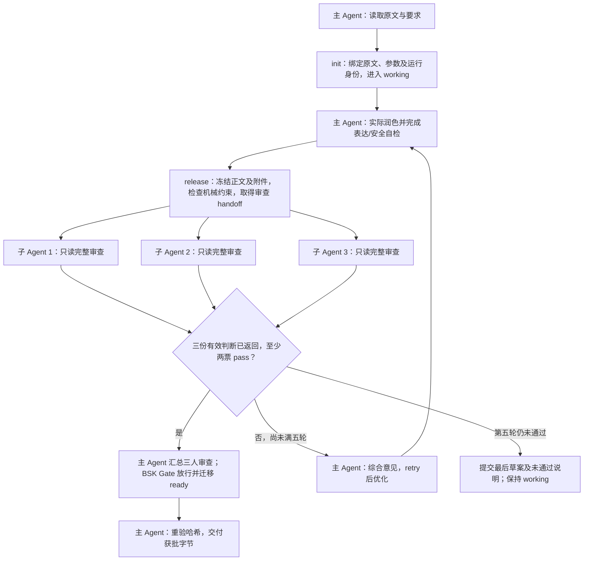

# humanization — 通用语言润色

[English](README_EN.md) · [执行规范](SKILL.md) · [参数配置](config.yaml) · [回归与评测](references/regression-cases.md)

让已有文字更自然、清楚、连贯。文章、邮件、报告、日常说明、学术和技术文字都可以直接润色：先理解内容与沟通意图，再改善句段推进、衔接、节奏和语气，同时保留事实、立场、必要边界与格式。原文已经清楚自然时，可以原样保留。

## 快速开始

```text
请润色下面这段文字，让表达自然、清楚、连贯，只返回正文。
保留原意、事实和语气，不补充新内容。

[粘贴原文]
```

明确要求润色已有文字即可触发，也可以点名 `humanization`。默认自动适配原文的语言、用途与语气，适中改写，保持原行段结构，内部进行两轮表达/安全复核，直接返回正文。无需先选择风格；只做诊断时使用 `output_mode=diagnosis_only`。

需要安装时，在本仓库使用 Python 3.11+ 运行：

```bash
python3 skills/alpha/install-bensz-skills/scripts/install.py --skill humanization
```

自然语言和安装参数兼容旧名 `nsfc-humanization`，正式安装目录只有 `humanization`；旧名不再限定处理领域。

## 适用范围

适用于已有文本的语言润色、去机器味、调整语气、改善句段衔接：博客文章、邮件、工作报告、产品说明、学术论文和技术文档均可。中文、英文和中英混合文本保留原语言，按各自语言习惯编辑。读者、用途或风格未指定时沿用原文，不会要求先选参数。只说“解释一下缓存”属于普通问答，不会自动调用它。

本 Skill 处理已有内容的表达，不负责从零写作、补充事实、检索/核查证据、纯翻译或改版式。提示词行为设计可用 `better-prompt`，项目 README 的完整撰写可用 `write-readme`；只润色这些材料里的自然语言时可以用本 Skill。规则只在本次调用范围生效，不会改变全局对话风格，也不保证复制某个模型的写作体验。

## 从调用到交付，AI 如何工作

主 Agent 负责理解、润色、自检、根据意见继续优化和最终交付；三个独立子 Agent 并行审查同一冻结产物，每人完整核对语义、保护内容和表达收益。三份有效判断全部返回后，至少两票 pass 才能过关，保留少数意见。未过关由主 Agent 改稿后重审，最多五轮；第五轮仍未通过就停止优化，提交最后一轮草案，并说明未通过原因供用户判断。



并行调度由宿主通过 `parallel-vibe` 完成：先启动三人再等待，每人只读自己的 handoff，不读取其他人的结果、不代写正文。BSK 不会自动启动模型或子 Agent；无真实并行能力时报告受阻，不能降级成主 Agent 自审。

例如“我们计划周五提供报告”改成“我们保证周五提供报告”，即使日期和对象不变，也升级了承诺，审查者应判失败。若三人给出 pass/pass/fail，票数门槛满足且机械检查通过即可交付，并保留第三人的异议；pass/pass/缺票仍未完成。结构、身份、哈希或授权错误不能靠多数票覆盖。

内部表达/安全自检默认两轮，与最多五轮的外部审查独立。同稿 pending、回传与恢复不增加外部轮次，retry 不清零；改稿后旧票作废。ready 只批准冻结产物，之后不能临时改词。独立上下文不等于模型偏差完全独立，身份和哈希字段也不认证真实调度。达到上限仍未通过时，即使 text_only 也会附一句“未通过审核，以下为最后一轮草案”及主要分歧，并提交草案；不把它标记为 ready。具体协议见[运行说明](references/runtime-control.md)。

## 风格与参数

参数由 Agent 读取，不是改写 CLI 的开关；默认值以 [config.yaml](config.yaml) 为准。

| 参数 | 取值与作用 |
| --- | --- |
| `style_profile` | `auto`（默认）：依据用途、读者和原文适配；`general_prose`：一般文字；`academic_general`：一般学术；`natural_explanation`：清晰亲切的解释；`technical_prose`：精确直接的技术说明；`professional_communication`：得体直接的职场沟通 |
| `section_type` | 可选文体职责提示，如 `通用`、`文章`、`邮件`、`报告`、`说明`；旧章节值仍可用，含义见配置，仅在原文或明确要求适用时参考 |
| `field` | `general`、`cs`、`engineering`、`medicine`、`life_science`；只调已有术语的语域 |
| `strength` | `minimal`、`moderate`（默认）、`aggressive`；控制表达改动幅度，不解除保护 |
| `structure_mode` | `preserve`（默认）保留行段结构；`reflow_plain` 显式允许连续纯文本重分段，遇 LaTeX/标题/列表/代码/表格回退保留结构 |
| `output_mode` | `text_only`（默认）、`text_with_change_summary`、`diagnosis_only`、`text_with_change_summary_and_style_card` |
| `self_eval_rounds` | `1` 或 `2`（默认）；上限由 `max_self_eval_rounds` 控制，只降低上限时默认轮数随之裁剪；一轮也核对表达与安全 |

风格选择优先遵循用户要求，其次看原文；线索不足时使用 `general_prose`。例如邮件不擅自增加道歉或承诺，学术文字不升级证据，技术说明不删除接口和必要步骤。旧参数和值继续可用；`nsfc_academic` 兼容为正式学术表达，不会附加基金章节模板。任何风格和改写强度都不能改变语义或格式权限。

## 进阶示例

### 邮件语气

```text
请用 humanization 润色下面这封邮件，发给合作同事。
语气自然、礼貌、直接，保留请求力度和时间安排，不增加道歉或承诺。

[粘贴原文]
```

### 技术与学术文本

```text
请用 humanization，style_profile=technical_prose，output_mode=text_with_change_summary，润色下面的技术说明。
保留接口名、代码、数值、条件和失败处理，不新增功能或步骤。

[粘贴原文]
```

### 跨段连贯性

```text
请用 humanization，structure_mode=reflow_plain，润色以下连续纯文本。
允许调整句序、合段或拆段；先解决思想衔接，再改措辞。
只用原文信息；output_mode=text_with_change_summary。

[粘贴原文]
```

一般学术文本可选 `academic_general`，面向非专业读者的解释可选 `natural_explanation`。需要跨章节去重时提供相邻段落。默认保留结构，仅给搬移建议；定义和边界若服务独立阅读，可以在不同章节保留。技术流程和真正并列的信息仍可用列表。

## 输出与保护检查

默认只返回干净正文，不附评分或诊断表；摘要模式简述实质变化与待确认项，详细审计表按需展开。语义不确定时保留原句，待确认说明放正文外。风格卡可供后续批次复用语域、术语和边界。

## BSK 交付门禁

Skill 通过 BSK 记录 working/ready 两个领域阶段，保留原有一个 required 混合 Verifier 和唯一控制入口。主 Agent 直接依赖 parallel-vibe 调度三个子 Agent 并行审查，汇总为现有语义组件的一份结果；不新增审查 Pack、计票脚本或子 Agent 编排器。三份有效判断齐全且至少两票 pass，并通过 Kernel Gate，才作为获批正文交付。人数、票数及五轮上限由 Agent 按契约落实，BSK 继续负责原有机械检查、结果绑定和状态管理。

运行需要 Bensz 托管的 Python/BSK 及已安装的 install-bensz-skills。Agent 使用唯一入口 `scripts/control.py`；初始化会通过安装器确认最新生产版，不使用项目 Python 或裸 PATH 中的 bsk。正常自然语言调用方式不变，内部授权文本与证据暂存于该任务的 `humanization/input|output|log/`，正常通过时 `text_only` 仍只给正文；账本不复制原文。

[运行与恢复说明](references/runtime-control.md) 提供请求格式、入口命令、真实 handoff 回传及重试方式。初始化或重试中断后可在原目录用同一身份恢复；交付回执从真实事件与冻结字节重建。此项将运行时和真实审查作为交付前提：环境或审查不可用时保留草案并说明受阻。BSK 约束经过该入口的行为，无法拦截宿主绕开入口直接发消息或写文件；它也不能证明语义判断一定正确。

## 字面辅助检查

中文夹杂技术标记的文件，可用标准库辅助脚本作保守比较，两个输入均只读：

```bash
python3 skills/alpha/humanization/scripts/check_revision.py original.txt revised.txt --structure-mode preserve
```

退出 `0` 表示所覆盖的字面保护检查通过，`1` 表示有差异，`2` 表示输入或模式无法可靠检查。脚本检查常见 LaTeX 参数、数学、引用、注释、代码、数字、英文 token 和行结构；复杂 TeX 宏需人工复核。普通英文改写也会被报为差异，纯文本中的百分号和货币符号也可能被当作 TeX 语法；这些场景采用人工比对，不为通过检查冻结英文正文。脚本不能判断意图、承诺、分母替换或因果升级等语义变化，字面通过始终还需语义核对。可从任意目录用脚本绝对路径运行。

## FAQ

**会把每段都写成观点句开头吗？** 不会。段落形状由内容决定，允许铺垫、比较和推理，过渡也可通过语义自然完成。

**会把所有文字都写成学术语气吗？** 不会。默认根据用途、读者和原文适配语域，文章、邮件和解释保留各自的表达习惯。

**会删除所有英文和否定句吗？** 不会。普通英文可自然改写，专名和技术标记保持稳定；必要区分、独立限定和技术结构都保留，首次释义需要原文支持。

**为何不直接用最大强度？** 自然度不等于改动量。默认适中，先比较原稿与改稿的实际收益，优秀原文允许免改。

**能补足缺少的论证吗？** 只能重新连接原文已有的信息。缺少证据或必要解释时会保留缺口供作者补充。

## 评测与局限

[回归样例](references/regression-cases.md) 覆盖文章、邮件、说明、英文编辑、句段推进、伪对立、过度结构化、解释不足、专业边界、免改、LaTeX 和语域差异，并给出八维量表与匿名评审入口。[自然写作原则](references/natural-writing.md) 解释正向组织方法，[模式参考](references/machine-patterns.md) 用于定位具体障碍。

自动测试可发现字面保护和格式回归，不能证明文章更自然。小样本同模型 Agent 比较只作初步证据，仍需要真实长文、重复盲评和用户反馈；不将自评或参考改写当成实测成功。

版本唯一来源为 [config.yaml](config.yaml)，历史见 [CHANGELOG.md](CHANGELOG.md)。

中文 README.md 与英文 README_EN.md 保持对齐。
