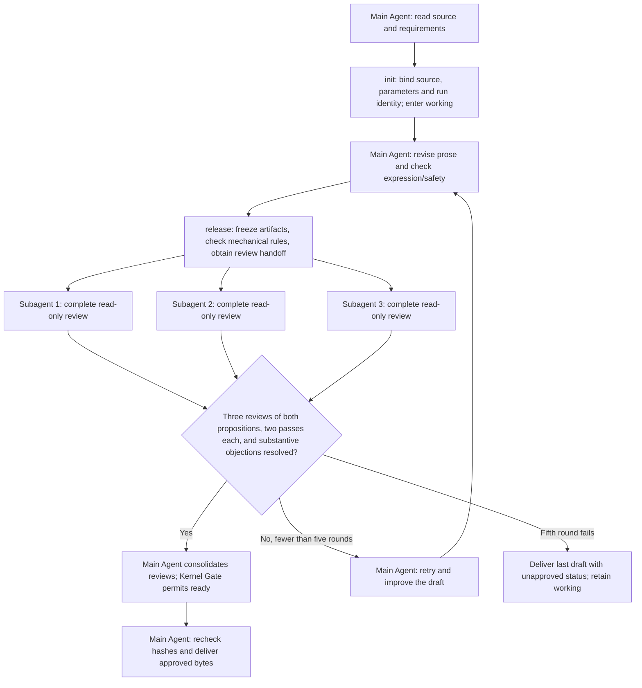

# humanization — Natural prose editing

[中文](README.md) · [Execution contract](SKILL.md) · [Configuration](config.yaml) · [Regression and evaluation](references/regression-cases.md)

Make existing prose natural, clear and coherent. Edit articles, emails, reports, everyday explanations, academic writing and technical documents: understand the content and intent, then improve progression, transitions, rhythm and tone while preserving facts, stance, necessary boundaries and formatting. Already effective prose may remain unchanged.

This release includes a dedicated defensive-framing review. Existing installations need an installer update to use the behavior described below.

## Quick start

```text
Polish the following text so it reads naturally, clearly and coherently. Return only the prose.
Preserve the meaning, facts and tone. Add no new content.

[Paste source text]
```

A clear request to polish existing text can trigger the Skill; naming `humanization` also works. Defaults adapt to the source language, purpose and tone, with moderate editing, original line and paragraph structure, and two internal expression/safety reviews. No style selection is required. Use `output_mode=diagnosis_only` for diagnosis without rewriting.

To install, run from this repository with Python 3.11+:

```bash
python3 skills/alpha/install-bensz-skills/scripts/install.py --skill humanization
```

Natural language requests and installer arguments accept the legacy name `nsfc-humanization`; the installed directory is always `humanization`. The legacy name no longer restricts the subject area.

## Scope

Use it to polish existing prose, reduce formulaic wording, adjust tone or improve transitions in blog posts, emails, work reports, product explanations, academic papers and technical documents. Chinese, English and mixed text retain their language and follow its conventions. Without a specified audience, purpose or style, it follows the source rather than asking for parameters. An ordinary request such as “explain caching” does not trigger it automatically.

This Skill edits the expression of existing content. It does not write from scratch, supply facts, retrieve/verify evidence, perform translation alone or change layouts. Use `better-prompt` to design prompt behavior and `write-readme` to author a complete project README; this Skill can polish the natural language within those materials. Its rules apply within the current invocation without changing global conversation style or promising to reproduce a particular model's writing experience.

## How the AI works, from invocation to delivery

The main Agent understands the source, writes and improves the prose, performs expression/safety checks, and delivers the final result. Three independent subagents review the same frozen artifacts in parallel. Each reviews two propositions separately: semantic and delivery safety, and defensive framing with necessary boundaries preserved. Each proposition requires three completed judgements, at least two pass votes, and all substantive objections resolved. Minority style preferences are retained. If the round fails, the main Agent revises and requests another review, up to five review rounds. After a failed fifth round, stop optimizing and deliver the last draft with a brief explanation of its unapproved review status, so the user can decide whether to use it.



The host dispatches all three reviewers before waiting, through `parallel-vibe`. Each reads the current handoff and frozen artifacts, without seeing the others' votes or editing prose. BSK does not start models or subagents itself. Without real parallel subagent support, retain the draft and report the blocker; main-Agent self-review cannot replace the panel.

For example, changing “we plan to send the report on Friday” into “we guarantee delivery on Friday” strengthens a promise even though the date is unchanged. The reviewers should identify this. Pass/pass/fail meets the voting threshold for one proposition, but a substantive objection from the third reviewer still requires a correction and new review, or a dismissal supported by source and candidate evidence. Unresolved substantive objections block delivery. Minority style preferences may remain; pass/pass/missing is incomplete. Votes cannot override structural, identity, hash or authorization errors.

The default two expression/safety checks are separate from the five external review rounds. Pending submissions, readbacks and recovery do not consume another round; retries do not reset the budget. Edits require new votes. Ready approves only the frozen bytes. Separate contexts do not guarantee independent model biases, and identity fields do not authenticate actual dispatch. At the five-round limit, even text_only includes a short unapproved-status note and the last draft; this fallback does not mark the draft ready. See the [runtime guide](references/runtime-control.md).

## Styles and parameters

Parameters are read by the Agent; they are not rewrite CLI flags. Defaults are defined in [config.yaml](config.yaml).

| Parameter | Values and purpose |
| --- | --- |
| `style_profile` | `auto` (default): adapt to purpose, audience and source; `general_prose`: general writing; `academic_general`: general academic prose; `natural_explanation`: clear, approachable explanation; `technical_prose`: precise, direct technical prose; `professional_communication`: courteous, direct workplace communication |
| `section_type` | Optional document role hint, such as `通用`, `文章`, `邮件`, `报告` or `说明`; legacy section values remain valid, as defined in the configuration, and apply only when supported by the source or explicitly requested |
| `field` | `general`, `cs`, `engineering`, `medicine`, `life_science`; adjusts the register of existing terminology only |
| `strength` | `minimal`, `moderate` (default), `aggressive`; controls expression changes without relaxing protection |
| `structure_mode` | `preserve` (default) keeps line and paragraph structure; `reflow_plain` explicitly permits reparagraphing continuous plain text, falling back to preservation for LaTeX/headings/lists/code/tables |
| `output_mode` | `text_only` (default), `text_with_change_summary`, `diagnosis_only`, `text_with_change_summary_and_style_card` |
| `self_eval_rounds` | `1` or `2` (default), capped by `max_self_eval_rounds`; lowering only the cap also reduces the default rounds; one round still checks expression and safety |

Style selection follows user requirements first, then the source; without clear cues, it uses `general_prose`. Emails gain no unsolicited apologies or promises, academic prose gains no stronger evidence, and technical explanations retain interfaces and necessary steps. Existing parameters and values remain valid. The legacy `nsfc_academic` value maps to formal academic writing without imposing grant section templates. No style or editing strength changes meaning or formatting permissions.

## Advanced examples

### Email tone

```text
Use humanization to polish this email to a colleague.
Keep it natural, polite and direct. Preserve the request's force and schedule; add no apologies or promises.

[Paste source text]
```

### Technical and academic text

```text
Use humanization with style_profile=technical_prose and output_mode=text_with_change_summary to polish this technical explanation.
Preserve interface names, code, numbers, conditions and failure handling. Add no features or steps.

[Paste source text]
```

### Coherence across paragraphs

```text
Use humanization with structure_mode=reflow_plain to edit this continuous plain text.
You may reorder sentences, merge or split paragraphs. Resolve idea progression before polishing wording.
Use only the source information; output_mode=text_with_change_summary.

[Paste source text]
```

Use `academic_general` for academic prose or `natural_explanation` for explanations to nonspecialists. Provide adjacent paragraphs for cross-section deduplication. Structure is preserved by default, with relocation suggested separately. Definitions and boundaries may recur where sections need to stand alone. Technical procedures and genuinely parallel information may still use lists.

## Output and protection checks

The default returns clean prose without scores or diagnostic tables. Summary modes briefly describe substantive changes and unresolved issues; detailed audit tables are available on request. Uncertain sentences remain unchanged, with review notes outside the prose. A style card can carry the register, terminology and boundaries into later batches.

## BSK release gate

BSK retains working/ready stages and the single control entry, with two required hybrid Verifiers: revision-readiness and defensive-framing. The former protects semantic and delivery safety; the latter checks empty disclaimers, imagined rebuttals and necessary boundaries after editing. The main Agent uses parallel-vibe to dispatch the same three reviewers and consolidates their actual judgements for each proposition separately. The entry validates structured records, hashes, declared identities, votes and substantive-objection resolutions. Both propositions must meet their thresholds before the BSK Gate permits release. These checks do not authenticate real identities or prove that judgements are correct; actual dispatch and the five-round budget remain the main Agent’s responsibility.

Execution requires Bensz managed Python/BSK and an installed install-bensz-skills. The Agent uses one entry, `scripts/control.py`; initialization asks the installer to confirm the latest production runtime instead of using project Python or a bare bsk from PATH. Natural-language invocation stays the same. Authorized text and internal evidence are staged in the task's `humanization/input|output|log/`; approved `text_only` output remains prose only, and the event ledger does not copy the source text.

The [runtime and recovery guide](references/runtime-control.md) covers requests, commands, actual handoff submissions and retries. The new approval contract requires both reviews. Historical records can be read back only under their original contract snapshot; the new source rejects asset drift in old runs and does not promote an old approval into approval under both gates. Interrupted initialization or retry can resume in the same directory with the same identity; release receipts are rebuilt from actual events and frozen bytes. A working runtime and real review are now release prerequisites: when unavailable, the draft is retained and the blocker is reported. BSK controls actions passing through this entry; it cannot intercept messages or file writes that bypass it, nor prove that semantic judgments are correct.

## Lexical helper checks

For Chinese text containing technical tokens, use the standard-library helper for a conservative comparison; both inputs are read only:

```bash
python3 skills/alpha/humanization/scripts/check_revision.py original.txt revised.txt --structure-mode preserve
```

Exit `0` means the covered lexical protection checks passed, `1` means differences were found, and `2` means the input or mode could not be checked reliably. The helper checks common LaTeX arguments, math, citations, comments, code, numbers, English tokens and line structure. Complex TeX macros require human review. Ordinary English edits also appear as differences, and percent or currency symbols in plain text may be treated as TeX syntax. Compare those cases manually instead of freezing English prose to pass the check. The helper cannot judge intent, promises, denominator changes or stronger causal claims; a lexical pass always requires semantic review. The script can run from any directory using its absolute path.

## FAQ

**Must every paragraph start with a claim?** No. Content determines paragraph shape; setup, comparison and inference are valid, and transitions can follow naturally through meaning.

**Does everything become academic prose?** No. The default adapts to purpose, audience and source, preserving the conventions of articles, emails and explanations.

**Does it remove all English terms or negative statements?** No. Ordinary English can be edited naturally, while names and technical tokens remain stable. Necessary distinctions, independent qualifications and useful technical structure remain. First-use explanations require source support.

**Why not always use maximum strength?** Naturalness is not the amount of editing. The default is moderate, with an explicit comparison of source and revision. Good source prose may remain untouched.

**Can it fill a missing argument?** It can reconnect information already in the source. Missing evidence or explanations remain for the author to supply.

## Evaluation and limits

[Regression cases](references/regression-cases.md) cover articles, emails, explanations, English editing, progression, false contrasts, excessive structure, missing explanation, professional boundaries, no-change cases, LaTeX and register differences, with an eight-dimension rubric and an anonymous review procedure. [Natural writing principles](references/natural-writing.md) explain positive organization; the [pattern reference](references/machine-patterns.md) helps locate specific obstacles. The [defensive-writing reference](references/defensive-writing.md) uses five questions and six functional categories to distinguish empty framing from necessary qualifications; keyword matches are clues only.

Automated tests can detect lexical and formatting regressions, not prove better prose. Small comparisons judged by Agents using the same model provide preliminary evidence only. Real long-form texts, repeated blind reviews and user feedback remain necessary; synthetic evaluations can check the protocol and constructed cases, but cannot establish real writing quality or the incremental benefit of the added gate. Self-assessment and illustrative revisions are not successful benchmark runs.

The sole version source is [config.yaml](config.yaml); see [CHANGELOG.md](CHANGELOG.md) for history.

Chinese README.md and English README_EN.md are kept aligned.
